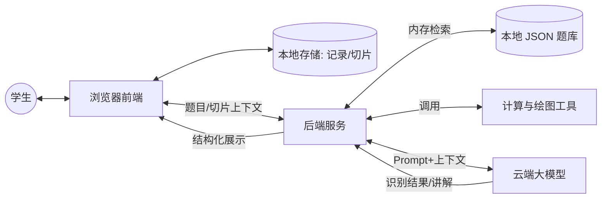
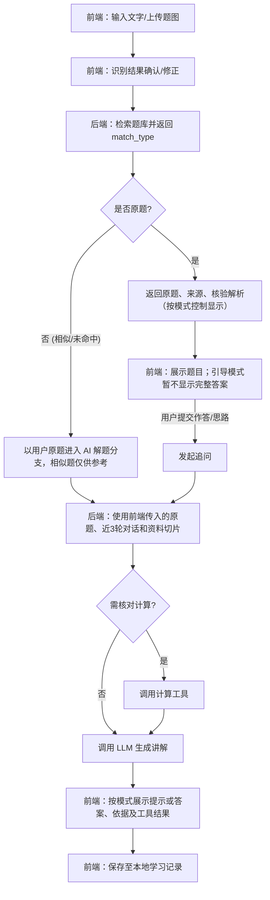
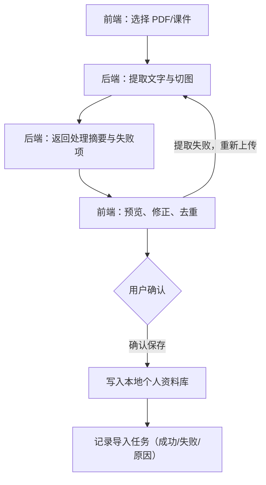
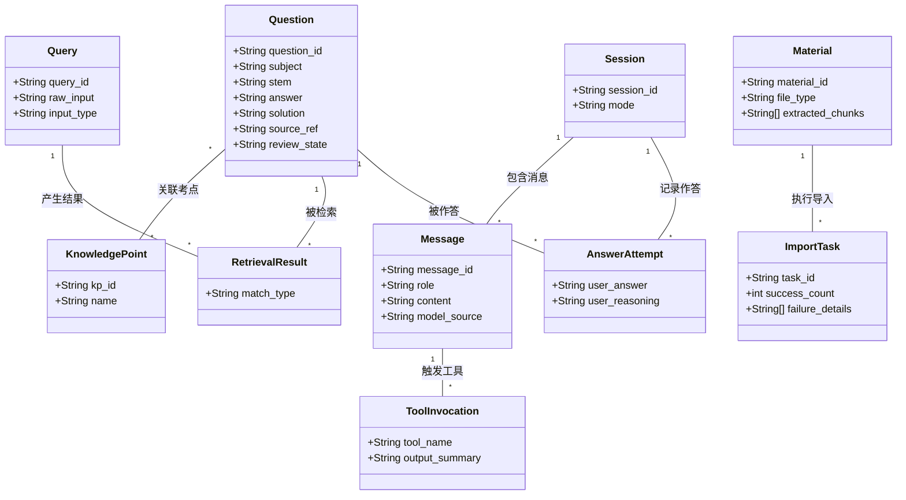

# 408智能体（问径）项目：开发基准与设计规范

> 修订日期：2026-10-29。状态：接口更改建议，待 TL 与叶凯乐确认并同步 Apifox 后生效。
> 本版沿用三个学习接口的字段名，补充调用语义、示例和验收要求。文档更新不表示功能已经实现，也不表示线上 Mock 已同步。待决定的扩展单列在第六节。

### 本次修订摘要

- 明确相似题只是参考，用户仍可针对自己的原题答疑。
- 补充三态响应关系、未命中时的题干传递和最近三轮上下文规则。
- 明确引导模式下题库答案、模型回复和工具结果的显示时机。
- 补充图片检索与资料上传的衔接、确认保存及失败处理。
- 将筛选字段、相似题章节、未核验题策略和健康检查列为团队决策项。

## 一、 业务底线
1.  **冲突处理**：优先展示题库核验解析。若模型讲解与原答案冲突，必须同屏展示差异，不可覆盖原答案。
2.  **防幻觉**：未命中题库时，模型可尝试解题，但**严禁编造**真题年份、教材页码等出处；联网搜索答案必须核验。
3.  **三态严格隔离**：后端接口必须返回 `match_type` (原题/相似/未命中)。相似题仅作参考展示，不可代替用户原题进入作答与追问。`similar` 和 `miss` 均可围绕用户原始题干继续答疑，此时 `question_id` 为 `null`，不得传入相似候选的 ID。
4.  **前端无状态切片**：个人资料可经 `/api/upload` 临时传到后端解析，但不写入后端资料数据库。用户确认后的文本保存在浏览器本地，由前端切片后通过 `context_chunks` 随请求发送；后端用于构造当前模型请求。

---

## 二、 核心架构与数据流图

### 1. 系统交互架构


### 2. 搜题与答疑数据流


### 3. 个人资料导入流


---

## 三、 数据模型规范
> 本部分用于指导前端 LocalStorage 的数据结构，以及后端 JSON 题库的字段设计。

### 1. 核心类图


### 2. 实体数据字典
| 实体名称 | 核心字段 | 字段说明/枚举值 | 持久化建议 |
| :--- | :--- | :--- | :--- |
| **Question** | question_id, stem, answer, review_state | `review_state`: 待核验/已核验/有争议。 | 公共题库(JSON) |
| **KnowledgePoint** | kp_id, name | 用于同考点推荐及知识树。 | 公共题库(JSON) |
| **Query** | query_id, raw_input, input_type | `input_type`: 文字/图片。 | 仅内存传递 |
| **RetrievalResult**| match_type, question_id | `match_type`: 原题/相似题/未命中。 | 仅内存传递 |
| **Session** | session_id, mode | `mode`: 直接解析/引导解题。 | 前端 LocalStorage |
| **Message** | message_id, role, content | `role`: user/assistant。 | 前端 LocalStorage |
| **AnswerAttempt** | user_answer, user_reasoning | 引导模式下的作答。 | 前端 LocalStorage |
| **Material** | material_id, extracted_chunks | `extracted_chunks`: 前端切片文本数组。 | 前端 LocalStorage |
| **ImportTask** | task_id, failure_details | 记录导入摘要与失败原因。 | 前端 LocalStorage |
| **ToolInvocation** | tool_name, output_summary | 附加在 Message 中。 | 前端 LocalStorage |

---

## 四、 API 契约规范

### 1. 全局接口概览
| 接口 | 方法 | 入参概览 (JSON/Form) | 出参概览 (JSON) |
| :--- | :--- | :--- | :--- |
| `/api/search` | POST | `raw_input`, `input_type` | `match_type`, `question_data`, `similar_questions` |
| `/api/chat` | POST | `session_messages`, `question_id`, `user_answer`, `mode`, `context_chunks` | `reply`, `tool_result`, `citations` |
| `/api/upload` | POST | `file` (form-data) | `task_id`, `extracted_text`, `failure_details` |

---

### 2. 接口详细定义（Apifox 落地与代码实现）

#### 接口 1：查题检索 `POST /api/search`
*   **请求 Body**：
```json
{
  "raw_input": "32位物理地址Cache...",
  "input_type": "text"
}
```
*   **成功响应（原题命中）**：
```json
{
  "match_type": "original",
  "question_data": {
    "question_id": "Q001",
    "subject": "计算机组成原理",
    "stem": "32位物理地址...",
    "answer": "A",
    "review_state": "verified"
  },
  "similar_questions": []
}
```
*   **成功响应（未命中）**：
```json
{
  "match_type": "miss",
  "question_data": null,
  "similar_questions": []
}
```

**请求语义与响应约束（本版建议）**：

- `raw_input` 是非空题干文本。`input_type` 为 `text` 或 `image`；`image` 表示文本来自题图识别，并不表示这里接收图片文件或 Base64。图片先走上传解析，用户确认识别结果后再查题。
- PR #3 的实现将空白或超过 4000 字符的题干判为 422；建议在 Apifox 同步这一限制。输入无效不是题库未命中，不能用 `miss` 代替校验错误。
- 当前请求仍只有 `raw_input`、`input_type`；本版不增加学科、年份、题号筛选参数。
- 响应始终包含 `match_type`、`question_data`、`similar_questions`。三态关系如下：

| 状态 | question_data | similar_questions | 答疑对象 |
| --- | --- | --- | --- |
| original | 原题对象 | 空数组 | 已确认原题，携带其 ID |
| similar | null | 非空候选数组 | 用户原题，ID 为 null；候选仅作参考 |
| miss | null | 空数组 | 用户原题，ID 为 null |

**成功响应（相似题，仅为结构示例）**：

```json
{
  "match_type": "similar",
  "question_data": null,
  "similar_questions": [
    {
      "question_id": "DEMO-Q001",
      "subject": "计算机组成原理",
      "stem": "一道同考点的参考题，条件与用户输入不同",
      "source_ref": "团队原创演示题"
    }
  ]
}
```

原题完整对象需要展示题干、选项、答案、解析和来源。PR #3 当前对象包含 `question_id`、`subject`、`chapter`、`stem`、`options`、`answer`、`solution`、`review_state`、`source_ref`；上方原题示例只展示部分字段。叶凯乐需核对 Apifox 中的完整定义及必填项，不能把代码中的默认值自动视为已批准的契约。相似题摘要目前只有上方四个字段，不默认包含 `chapter`、答案或解析。

`original` 应有足够证据确认是同一道题，不能仅凭检索高分复用答案。参数、问法、正负号、单位、选项顺序或条件不一致时，应作为相似候选处理。未核验题默认如何降级见第六节。

#### 接口 2：对话答疑 `POST /api/chat`
*   **请求 Body**：
```json
{
  "session_messages": [
    {"role": "user", "content": "某 Cache 有 1024 行，采用四路组相联，组号占几位？"},
    {"role": "user", "content": "我认为四路就表示四组，所以组号占2位，对吗？"}
  ],
  "question_id": null,
  "user_answer": "因为四路，组号占2位",
  "mode": "guided",
  "context_chunks": ["个人资料切片1", "个人资料切片2"]
}
```
*(注：`mode` 枚举为 `direct` 或 `guided`)*
*   **成功响应**：
```json
{
  "reply": "你提到的四路组相联，其实指每组包含的行数...",
  "tool_result": "",
  "citations": []
}
```

**消息与模式规则（本版建议）**：

| 字段 | 类型与用法 |
| --- | --- |
| session_messages | `{role, content}` 数组；role 为 user/assistant，content 为字符串。首条放完整原题，后接最近最多三轮消息（最多六条，含本次用户追问）；首次也必须带题干。按当前会话取消息，不混入其他会话。 |
| question_id | 字符串或 null。仅 original 使用已确认的题库 ID；similar/miss 使用 null，不用空字符串或相似题 ID 替代。 |
| user_answer | 字符串；无作答时传空字符串。 |
| mode | direct 或 guided。 |
| context_chunks | 字符串数组；无个人资料时传空数组。 |
| reply | 字符串；模型讲解或引导提示。 |
| tool_result | 字符串；无工具结果或本轮需隐藏完整结果时传空字符串。 |
| citations | 字符串数组；只包含有依据的来源，无可核验来源时传空数组。 |

以上对 `question_id` 可空、空值写法及各字段类型的明确，需要同步 Apifox 校验与 Mock；字段名称不变，但不能省略联调确认。

- `direct`：可展示完整答案与解析。`guided`：初始只给提示，题库答案、完整解析以及会直接暴露答案的工具结果均暂不展示。前端隐藏和 Agent 输出约束需同时生效。
- 用户主动点击“查看答案”后，前端可展示题库答案，并用已有的 user 消息表达查看完整答案的意图；不新增 HTTP 字段。PR #2 当前使用的消息为“我已主动选择查看答案，可以结合完整答案继续讲解。”，本地 `answer_revealed` 不是请求字段。后端应理解明确的用户意图，不依赖逐字匹配这句话。
- 若查看答案的意图已超出最近三轮，而本地仍处于已揭示状态，需决定是否继续携带这一意图；当前 PR #2 的行为需联调核对。未确认前不假定后端会记住浏览器状态，也不私自新增 `answer_revealed` 参数。
- 题库核验解析与模型讲解分开展示；发现矛盾时标明差异，不能覆盖题库答案。引导模式下涉及最终答案的差异详情也需等用户主动查看。
- 上方示例中的行数是演示条件。1024 行、四路对应 256 组、8 位组号；guided 初始回复应引导用户先算组数，而非直接给出 8 位。没有总行数或等价条件时，先追问缺失条件，不猜位数。

#### 接口 3：文件上传 `POST /api/upload`
*   **请求格式**：`form-data` (键名 `file`，类型 File)。
*   **成功响应**：
```json
{
  "task_id": "task_12345",
  "extracted_text": "提取出来的全部纯文本内容...",
  "failure_details": []
}
```

---

### 3. 上传与错误处理补充（本版建议）

- `/api/upload` 采用当前一次请求返回解析结果的方式；`task_id` 用于记录此次导入，不代表已有异步轮询接口。
- `extracted_text` 为字符串；建议将 `failure_details` 明确为字符串数组，无失败时为 `[]`。这需要叶凯乐与解析负责人确认并同步 Apifox；本版不引入页级对象或新的返回字段。
- 部分解析成功时返回已有文本和失败说明；前端让用户预览、修正并明确确认后保存。无可用文本时不能提示导入成功或保存空资料。
- 只有用户确认后的文本才写入本地资料库；重复确认同一份资料不重复新增。网络失败或重新上传不会自动覆盖已有资料。
- 网络超时、非 2xx 响应和解析失败应与“题库未命中”分开显示。聊天请求失败保留用户输入，允许重试；上传失败显示原因。不能静默切换到演示数据并当作真实成功。
- 本版不统一更换错误响应结构。`/api/chat`、`/api/upload` 的具体错误状态码、文件格式和大小限制由负责人在联调前补齐，不能沿用 `/api/search` 的 422 去推断全部错误。

---

## 五、 验收与测试红线（QA 与 Agent 调试依据）
1.  **三态隔离**：相似候选不可替代原题追问；similar/miss 围绕用户原题答疑时传 null ID，消息包含完整原题。原题命中按模式展示题库核验解析。
2.  **冲突展示**：模型与题库解析相悖，必须呈现差异。
3.  **防幻觉**：未命中时，禁止模型虚构真题来源。
4.  **引导不泄底**：`mode=guided` 时，初始回复不展示最终答案，仅提供分步提示。
5.  **资料导入**：摘要须反映真实处理结果；预览修正并确认后才保存，支持失败重试，不保存空资料。
6.  **Cache 基准案例**：指出“四路不等于四组”，依据完整题目计算组数（行数/4）。缺少条件先追问；guided 初始不泄露最终数值，direct 或主动查看答案后可给出完整结果。

## 六、 待团队确认的扩展与采用顺序

以下不是本版新增的正式接口字段，不要求成员现在实现。

| 事项 | 建议 | 确认后影响 |
| --- | --- | --- |
| 学科、年份、题号独立检索 | 本轮先保留题干检索。如确需定位检索，再定义 subject、year、question_no 的类型、可选性、组合约束及题库元数据。不能只加前端控件。 | 叶凯乐、检索与前端负责人共同更新 Apifox、题库、校验、Mock；还需决定是否允许不传题干、定位冲突怎么处理。 |
| 相似题 chapter | 当前四字段摘要足以展示参考题，建议暂不增加。若 UI 必须展示章节，再确认可选字段及缺省值。 | 相似题响应模型、Mock 与前端展示同步更新；不能因原题对象有 chapter 就假定候选也有。 |
| 未核验题策略 | 建议沿用 PR #3 的默认 downgrade：未核验或有争议的题目不作为已核验 original。 | 在 Apifox 业务说明与 QA 中记录，并用正式题库验证检索效果；不是新增请求参数。 |
| GET /api/health | 建议保留 PR #3 已实现的部署自检用途，与三个学习接口分开登记。 | 林子涵与 TL 确认部署依赖；不把健康检查成功视为模型或 OCR 可用。 |
| 查看答案后的后续上下文 | 先验证最近三轮截断后能否持续表达用户已主动查看的意图，再决定是否需要结构化字段。 | 前端与 Agent 联调；若加字段须另行确认，不在本版暗中加入。 |

采用顺序：TL 与叶凯乐先确认本版语义和可空类型 → 同步 Apifox 请求/响应及 Mock → 各负责人检查现有实现 → QA 以真实接口复测。契约检查与前端 Mock 开发可并行；Mock 成功不代表真实模型、解析和部署已经验收。
